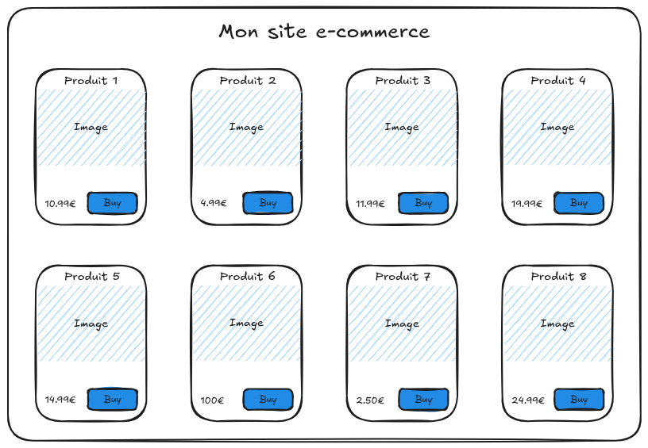
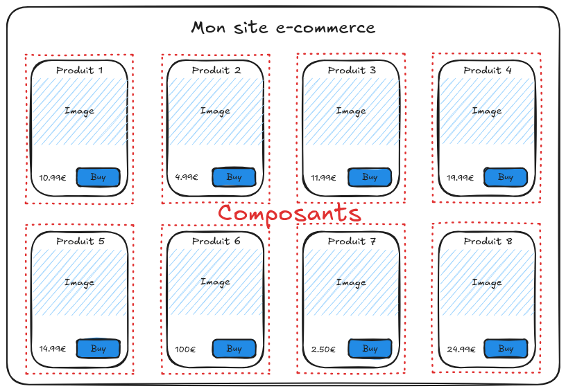
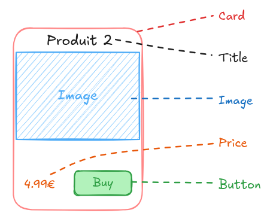
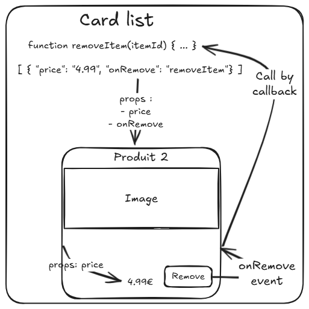

# 05 - Components

---

## Typical e-commerce page



---

## Page as components



---

## Component and subcomponents



---

## Need to share data



---

## In code

For Single File Components, each file is a component identified by its name

---

## Props to receive data

```vue
<script setup>
  import { computed, defineProps } from 'vue'
  const props = defineProps(['firstname', 'lastname'])
  const fullname = computed(() => props.value.firstname + ' ' + props.value.lastname)
</script>
<template>
  <p>{{ props.firstname }} {{ props.lastname }}</p>
  <p>{{ fullname }}</p>
</template>
```
---

## Destructuring props

```vue
<script setup>
  import { computed, defineProps } from 'vue'
  const { firstname, lastname } = defineProps(['firstname', 'lastname'])
  const fullname = computed(() => firstname + ' ' + lastname)
</script>
<template>
  <p>{{ firstname }} {{ lastname }}</p>
  <p>{{ fullname }}</p>
</template>
```

---

## Events

```vue
<script setup>
  import { defineEmits, ref } from 'vue';
  const emits = defineEmits(['submit']);
  const firstname = ref('John');
</script>
<template>
  <form @submit.prevent="emits('submit', firstname)">
    <input type="text" v-model="firstname"/>
    <button type="submit">Valider</button>
  </form>  
</template>
```